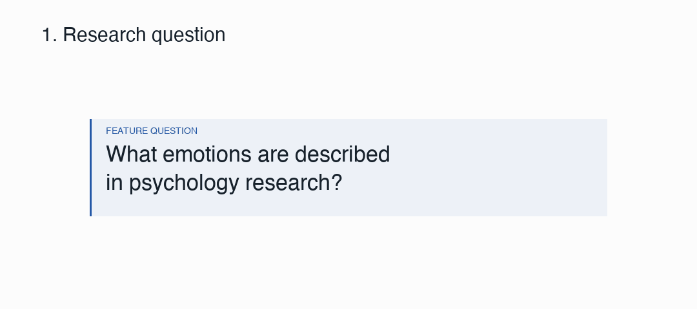
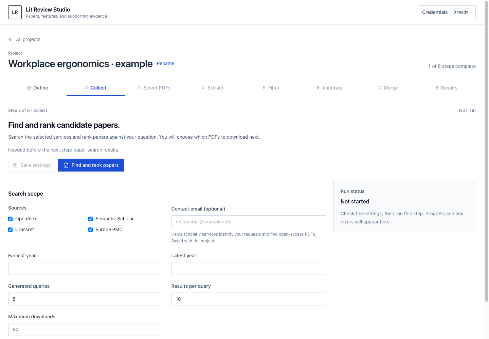

# Discovering features from existing literature

Collect research papers and build a feature inventory with definitions and supporting evidence.



## Install and open the UI

Requires Python 3.10+, [uv](https://docs.astral.sh/uv/getting-started/installation/), and Node.js 22+ to build the UI from source.

```bash
git clone https://github.com/Lamsheeper/lit-review.git
cd lit-review
uv sync
npm --prefix src/lit_review/ui/frontend ci
npm --prefix src/lit_review/ui/frontend run build
uv run lit-review ui
```

Open **[localhost:8765](http://127.0.0.1:8765)**. Add your Gemini or OpenAI API key under **Credentials**; it stays in memory for the session. Merging also uses a Gemini embedding key. For terminal runs, set `GEMINI_API_KEY` or `OPENAI_API_KEY` in your environment.

Create a project, define your question and taxonomy, then follow **Collect → Select/download → Extract → Filter → Annotate → Merge**. Inspect decisions and supporting evidence as you go; export the merged inventory to CSV or JSONL. Scoring is optional.



## Run a pipeline from the terminal

Start with a [ready-to-edit recipe](examples/README.md) for collection, review writing, feature discovery, or analysis. Advanced analysis and supplementary plots are optional: `uv sync --extra analysis`.

```bash
# Preview inputs and planned outputs without calling providers.
uv run lit-review pipeline run --config examples/features/pipeline.json --dry-run

# Run it; reuse matching completed stages on subsequent runs.
uv run lit-review pipeline run --config examples/features/pipeline.json
```

Use your own PDFs and taxonomy, or try the bundled synthetic example. Each run saves stage outputs and a manifest under its configured output root.

[Commands and configuration](docs/workflows.md) · [Local API](http://127.0.0.1:8765/docs) · [Importing older runs](docs/migration.md) · [Development](docs/development.md) · [Architecture](docs/architecture.md)
