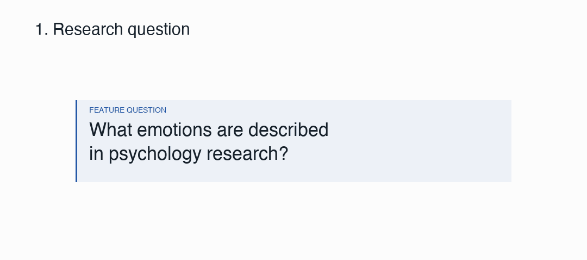
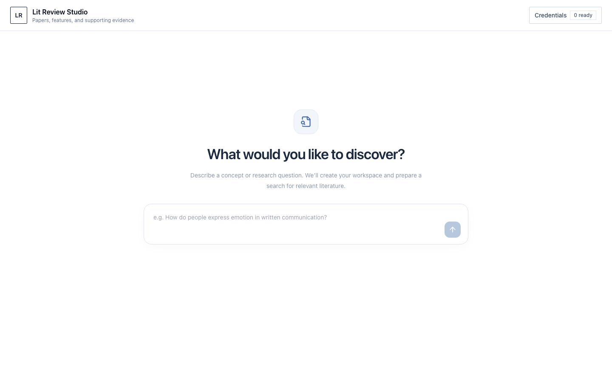

# Discovering features from literature collection

Collect research papers and build a feature inventory with definitions and supporting evidence.



## Install and open the UI

Requires Python 3.10+, [uv](https://docs.astral.sh/uv/getting-started/installation/), and Node.js 22+ to build the UI from source.

```bash
git clone https://github.com/Lamsheeper/lit-review.git
cd lit-review
uv sync
npm --prefix src/lit_review/ui/frontend ci
npm --prefix src/lit_review/ui/frontend run build
uv run lit-review ui
```

Open **[localhost:8765](http://127.0.0.1:8765)**. Add your Gemini or OpenAI API key under **Credentials**; it stays in memory for the session. For terminal runs, set `GEMINI_API_KEY` (or `GOOGLE_API_KEY`) or `OPENAI_API_KEY` in your environment. Gemini generation and embeddings also support Google Cloud through Vertex AI and Application Default Credentials (ADC).

To configure Google Cloud in the app, open **Credentials → Google Cloud**, enter your project and region, and click **Sign in with Google**. Open the Google sign-in link and paste the authorization code back into the app, then click **Check credentials**. The Google Cloud CLI must be installed on the machine running the app. Project and region defaults persist across restarts; gcloud stores the login credentials in its normal ADC location. Use a project with billing, the Vertex AI API enabled, and permission to access the models.

For terminal setup instead:

```bash
gcloud auth application-default login
export GOOGLE_CLOUD_PROJECT="your-project-id"
export GOOGLE_CLOUD_LOCATION="us-central1"
export GOOGLE_GENAI_USE_VERTEXAI=true
uv run lit-review ui
```

Choose **Google Cloud (ADC)** in the Gemini authentication settings, or leave **Automatic** to use these environment settings. Project and region can also be entered in the UI. Merging uses the same authentication for embeddings unless you override its embedding settings. ADC tokens refresh automatically; workloads can also use `GOOGLE_APPLICATION_CREDENTIALS` or an attached service account. See [authentication and configuration](docs/workflows.md#authentication) for CLI examples and precedence.

Before starting, provide a Gemini API key or configure Google Cloud ADC for the full workflow. If you choose OpenAI for text generation, Gemini credentials or ADC are still required for the merge step’s embeddings. The app checks these requirements up front, and checks selected full PDFs before extraction.

Enter a concept or research question to create your workspace. The app prepares a search brief and feature families automatically using your available model connection; required credentials are checked before starting. Then follow **Collect → Select/download → Extract → Filter → Annotate → Merge**. Inspect decisions and supporting evidence as you go; export the merged inventory to CSV or JSONL. Scoring is optional.



## Run a pipeline from the terminal

Start with a [ready-to-edit recipe](examples/README.md) for collection, review writing, feature discovery, or analysis. Advanced analysis and supplementary plots are optional: `uv sync --extra analysis`.

```bash
# Preview inputs and planned outputs without calling providers.
uv run lit-review pipeline run --config examples/features/pipeline.json --dry-run

# Run it; reuse matching completed stages on subsequent runs.
uv run lit-review pipeline run --config examples/features/pipeline.json
```

Use your own PDFs and taxonomy, or try the bundled synthetic example. Each run saves stage outputs and a manifest under its configured output root.

[Commands and configuration](docs/workflows.md) · [Local API](http://127.0.0.1:8765/docs) · [Importing older runs](docs/migration.md) · [Development](docs/development.md) · [Architecture](docs/architecture.md)
