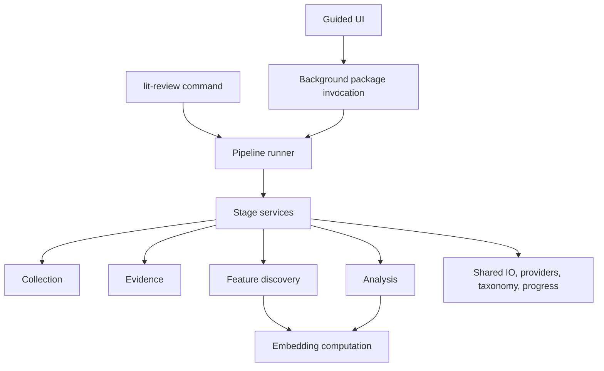

# Architecture

The public execution boundary is `lit_review.services`. Both the command line and UI submit stage settings to the pipeline runner; neither reconstructs shell invocations for individual research scripts.

## Responsibilities

- `core`: atomic artifact writers, HTTP transport, model clients, typed settings, taxonomy validation, text helpers, and task-local research context.
- `collection`: metadata sources, citation extraction/resolution, ranking, downloads, faculty-roster inventories, and service summaries.
- `evidence`: direct-PDF indexes, conversion, chunking/search indexes, retrieval, and review writing.
- `features`: extraction, filtering, annotation, scoring, and LLM-reviewed merging. Prompts, response repair, records, and artifact construction are separate modules.
- `embeddings`: feature text, provider clients, cache keys, numerical similarities, and clustering primitives. It has no visualization dependency.
- `analysis`: calibration, experiments, clustering orchestration, comparisons, plots, and Wikidata mapping analysis.
- `profiles`: opt-in media domain exclusions, aliases, instructions, title ranking, and embedding cleanup presets.
- `ui`: the API, SQLite project/job store, subprocess lifecycle, and React frontend.

## Stage contract

A stage has an ID, a supported operation, validated operation options, an output directory, and required artifacts. The runner connects the latest applicable collection/evidence/feature outputs unless a stage supplies explicit inputs. Generation configuration and taxonomy inputs are shared across feature stages.

A run contains `manifest.json`, `stages/<id>/`, and optional archived `history/` outputs. The manifest records effective configuration, input/code fingerprints, producer execution IDs, timing, status, output locations, artifact hashes, and execution results. API keys are resolved from named environment variables at execution and are excluded from persisted configuration.

Completed stages are reusable only when input contents, settings, package code, and required artifact hashes match. A changed predecessor makes later configured stages stale. Producer execution IDs propagate invalidation even when a rerun writes identical intermediate bytes. Mutable embedding caches are memoization and do not invalidate their own stage after filling. Failed stages retain matching batch ledgers for retry; changed inputs or explicit reruns archive previous output and start fresh. The runner stops on a failed stage and records interruption separately.

An exclusive run lock prevents overlapping execution. UI jobs also use a SQLite uniqueness constraint to prevent concurrent processing for a project. Readiness requires current successful records and valid artifacts, including valid empty inventories.

## Taxonomies and profiles

Feature workflows require a taxonomy with version, title, and ordered families. Every family has a stable snake-case ID, label, description, and aliases. Input inventories are checked against those IDs. Definition/annotation behavior is generic unless `profile: "media_attributes"` is explicitly selected.

The research context uses context variables so profile choices do not leak between concurrent requests or jobs. Media-specific title ranking is used only for the selected media profile. Historical calibration algorithms remain available as analysis operations.

## Installation

The package uses a `src` layout and exposes one entry point: `lit-review`. Frontend assets are included as package data after building them. Importing the UI module does not initialize a database; application startup initializes the configured project store.

The default installation supports collection, evidence, feature discovery, and the guided UI. The `analysis` extra adds plotting and statistical research dependencies. Feature-stage figures are supplementary; their absence does not block inventory exports. Feature services do not import analysis modules.
