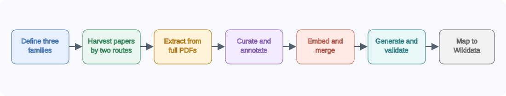
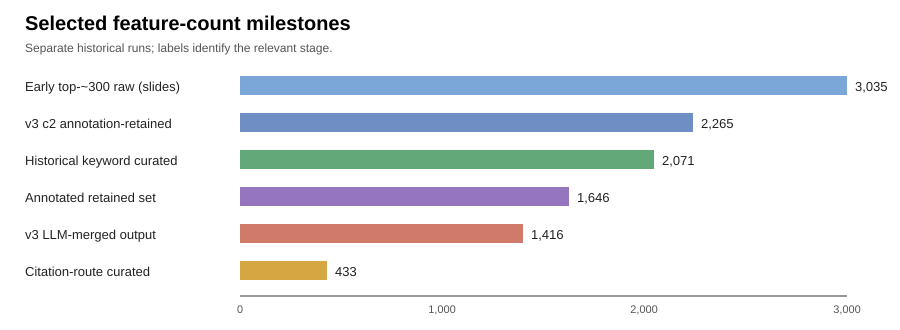

# Building an Evidence-Backed Taxonomy for Persuasion in Media

> Historical research report. The current release interface is documented in [workflows](workflows.md); experiments and counts below describe earlier runs.

**Program briefing and technical literature-review record** 
**Coverage:** May 4--August 24, 2026 
**Project:** `lit-review`

> **Evidence note.** This report distinguishes checked-in run artifacts from historical results recorded only in *persuasion weekly.pdf*. Counts can differ because the work progressed through several corpora, prompts, models, and filtering strategies. A number is never presented as a universal “final count” unless the underlying run supports that interpretation.

## Executive summary

The project asked a deceptively simple question: **what is a useful set of observable features for classifying persuasion in media?** A literature-derived inventory must be broad enough to cover rhetoric, moral language, and affect, but compact and distinct enough that people or models can apply it reliably. Direct aggregation does not meet that requirement. Papers use aliases, near-synonyms, umbrella categories, incompatible levels of abstraction, and constructs that describe analytic tasks rather than observable text.

We therefore built an end-to-end research pipeline that:

1. defines three non-interchangeable feature families;
2. harvests literature by broad keyword search and by citations from a curated core set;
3. processes full PDFs and extracts evidence-bound feature mentions;
4. curates, annotates, scores, and consolidates those mentions;
5. calibrates category-specific embedding merges on known taxonomies;
6. tests recognizability with controlled synthetic generation and independent annotation; and
7. extends the inventory into Wikidata graphs for semantic organization and institution discovery.

The main lesson is methodological: **literature support is necessary but not sufficient**. A practical codebook also needs operational definitions, separation of taxonomy roles, empirical distinctiveness, and annotation reliability. The repository now encodes that workflow as reproducible command-line tools and a guided local web application.

## 1. Research framing: three attribute families

The review preserves three kinds of claims about media text. Keeping them separate prevents a common category error: treating the rhetorical mechanism, the value it invokes, and the reaction it seeks as if they were the same label.

| Family | Question answered | Representative labels | Preferred unit |
|---|---|---|---|
| **Persuasion technique** | *How* is influence attempted? | loaded language, name-calling, bandwagon, appeal to authority, fear appeal, false dilemma, whataboutism, repetition | usually span or sentence |
| **Moral framing** | *Which moral principle* is activated? | care/harm, fairness/cheating, loyalty/betrayal, authority/subversion, sanctity/degradation, liberty/oppression | span, sentence, or frame-bearing passage |
| **Sentiment/affect** | *What is expressed or intended to be felt?* | anger, fear, disgust, sadness, hope, pride, empathy; valence/arousal/dominance as dimensions | target-aware span, sentence, or document |

Fine-grained propaganda datasets provided the strongest operational starting point for persuasion [@daSanMartino2019FineGrained; @daSanMartino2020SemEval; @dimitrov2021SemEval]. Moral Foundations Theory and its text resources anchored moral framing [@graham2011Mapping; @hoover2020MFTC; @araque2020MoralStrength]. GoEmotions, the NRC emotion lexicon, and EmoBank supplied complementary discrete and dimensional views of affect [@demszky2020GoEmotions; @mohammad2013NRC; @buechel2017EmoBank]. Work on moral-emotional diffusion also demonstrated why moral and emotional signals can interact without becoming the same construct [@brady2017MoralEmotion].

The target schema records a feature name, definition, sources and evidence context, synonyms, parent categories, examples, and notes. Multi-label annotation is expected: a passage can simultaneously use a false dilemma, invoke harm, and induce fear. Truth status, stance, ideology, actor agenda, and generic media bias remain downstream tasks unless a source also contributes an operational label to one of the three families.

## 2. Search methodology and selection criteria

The checked-in [`draft.md`](../examples/media_attributes/draft.md) defines research questions, candidate labels, Boolean-style queries, seed literature, inclusion criteria, and exclusions. [`goal.md`](../examples/media_attributes/goal.md) defines the extraction contract and required evidence fields. This separation is deliberate: the draft controls *what literature to find*; the goal controls *what evidence to extract*.

The collection layer (`lit_harvest.py`) uses scholarly metadata APIs rather than browser automation. Configurations include OpenAlex, Semantic Scholar, Crossref, and Europe PMC, with DOI-based open-access resolution through Unpaywall when configured. Candidates are deduplicated and ranked; manifests retain queries, source records, resolution attempts, and download status. Abstract-only surrogate PDFs were disabled for the principal runs so downstream extraction operated on actual papers.

Priority was given to work providing reusable taxonomies, annotation schemas, codebooks, corpora, label definitions, inter-annotator agreement, or construct validation. Pure stance detection, ideology prediction, fact checking, bot detection, and diffusion studies were excluded unless they also defined applicable persuasion, moral, or affect labels.

## 3. Two complementary paper-collection routes

### 3.1 Keyword/API collection

The broad route generated queries from the research draft and searched multiple metadata services. It maximized coverage but also admitted noisy matches caused by overloaded terms such as *classification*, *attribute*, *framing*, and *emotion*. The historical briefing run was capped at **1,000 papers** and produced **2,071 curated features** (*slides*, pp. 161 and 143). The current `media_attributes_v3` manifest reflects a later, larger corpus: **5,186 candidates and 2,601 downloaded PDFs**. These are different stages, not conflicting measurements.

A focused SemEval sanity check validated recall on a known inventory. Its manifest records **192 candidates and 176 PDFs**, and the slides report that all expected SemEval-2020 Task 11 features were covered (*slides*, p. 146). Expected labels remain checked in under [`sanity_checks/semeval_2020_task11`](../sanity_checks/semeval_2020_task11/).

### 3.2 Core-set citation expansion

The second route began with 16 intentionally selected anchor papers spanning propaganda, persuasion, moral foundations, emotion lexicons, argumentation, and annotation. Gemini extracted bibliography entries from the supplied PDFs under a constrained JSON schema; scholarly APIs then resolved and downloaded the cited works. The current manifest records **675 deduplicated candidates, 255 successful citation downloads, and 420 failed download attempts**. Together with the **16 seed PDFs**, the collection directory contains **271 PDFs**. Direct extraction yielded **1,004 features**, which the curation pass reduced to **433**.

Citation expansion supplied theoretical and historical depth that keyword ranking could miss, while the keyword route supplied breadth and newer application papers. Their different biases motivated direct comparison rather than choosing one route a priori.

| Collection/run | Candidates or papers | Raw features | Curated/retained features | Evidence |
|---|---:|---:|---:|---|
| SemEval sanity | 192 candidates; 176 PDFs | -- | expected inventory covered | manifest; slides p. 146 |
| Historical keyword run | 1,000 papers | -- | 2,071 | slides pp. 161, 143 |
| Current keyword v3 corpus | 5,186 candidates; 2,601 PDFs | stage-dependent | stage-dependent | v3 manifest |
| Core-set citation run | 675 candidates; 255 downloads + 16 seeds | 1,004 | 433 | manifest, directory, and feature CSVs |

## 4. PDF-processing benchmark and direct-PDF decision

Before scaling extraction, the project compared three bibliography-processing routes on six deliberately varied papers: clean one-column arXiv papers, two-column publisher layouts, references split across pages, and an older poorly formatted document.

- **Direct PDF to a document-capable LLM** preserved layout and avoided lossy intermediate parsing.
- **PDF to Markdown with PyMuPDF, then LLM** was transparent and indexable but inherited extraction-order and formatting errors.
- **PDF pages to 200-DPI images, then multimodal LLM** preserved appearance but increased data volume and processing overhead.

The slides contain model-specific benchmark plots (pp. 172--179), but the repository does not contain a compact machine-readable benchmark table from which exact accuracy/cost values can be re-derived. Accordingly, this report records the qualitative decision but does not invent numerical performance. Direct-PDF input became the principal feature-extraction route, while PyMuPDF/Markdown remained available for local conversion, search indexing, and citation extraction.

An earlier full-run comparison did retain aggregate counts: direct-PDF processing took approximately **1.27 hours**, extracted **1,711 raw features**, and curated **815** rows in the checked-in CSV (the slide rounds this to 816); the Markdown route took approximately **3.07 hours**, extracted **4,401**, and curated **1,919** (*slides*, p. 170). More output was not automatically better: the larger Markdown inventory also increased consolidation burden.

## 5. Evidence-bound extraction and curation

`LitSynth` converts papers to Markdown and creates a SQLite FTS/BM25 chunk index. `LitExtract` can then operate on chunks or full PDFs. The extraction prompt requires named features grounded in the supplied paper, rejects unsupported invention, and emits structured evidence including source paper IDs, titles, snippets, confidence, definitions, synonyms, examples, and parent categories.

Curation is a second LLM pass with three possible actions: `keep_as_canonical`, `merge_into_canonical`, or `reject`. Aliases are merged only when their definitions, taxonomy roles, and evidence align. Items are rejected when they are off-goal, overly broad, non-taxonomic, generic analytic tasks, or extraction artifacts. The pipeline is resumable through completed-paper and completed-batch ledgers, and trace files preserve prompts, configurations, errors, and run IDs.

The earliest slide-recorded experiment extracted **3,035 raw features from roughly 300 papers**, then reported **1,387** after curation, with **713 rejected and 935 merged** (*slides*, p. 184). Those figures describe an early run and are not arithmetically reconstructible as a single partition—merges can involve multiple members and the slide does not preserve the exact ledger—so they should be treated as historical milestone counts.

## 6. Comparing keyword and citation inventories

The comparison tooling ranks features by literature support and measures overlap at varying top-*k* cutoffs. It produces aggregate and per-category Jaccard curves, rank scatterplots, Venn diagrams, unique-feature tables, and later semantic-match files. The repeated rounds under [`comparison_plots`](../comparison_plots/) document refinement of normalization and matching rather than one immutable comparison.

The central finding was that the routes agreed most strongly on high-support concepts but each contributed plausible unique labels. Exact-string Jaccard underestimated agreement because aliases could appear under different canonical names; semantic comparison was therefore added in later rounds. The proposed selection rule was to locate the peak overlap for each category, take the union of both top-*k* lists at that point, and manually review the union. This preserves shared high-confidence features without discarding route-specific discoveries.

## 7. Annotation, scoring, and category-specific consolidation

### 7.1 Annotation and filtering

An LLM annotation pass wrote a formal definition, short definition, synonyms, examples, evidence basis, and inclusion status for each curated item. Strict filters removed umbrella constructs, measurement dimensions, and category labels. For affect in particular, retained items had to be emotions or affective states a person can actually experience. The slide-recorded and checked-in result is a reduction from **2,070 to 1,646 features** (*slides*, pp. 122--123; `annotated_features.csv`). The retained distribution is **1,094 persuasion**, **307 sentiment/affect**, and **245 moral-framing** features.

Feature scoring combined three 0--5 criteria:

- **literature support**, deterministically derived from paper count;
- **annotation reliability**, estimating whether independent annotators can identify the feature; and
- **distinctiveness**, estimating how much unique information would be lost if it were removed.

Later validation found that higher scores tracked annotation performance (*slides*, pp. 45--49), supporting score-based pruning. The precise correlation coefficient is not available in a checked-in summary, so the conclusion remains qualitative here.

### 7.2 Calibrating embeddings on known taxonomies

Blind cosine-threshold merging was unsafe because related concepts are not necessarily aliases. The project used SemEval-2020 Task 11 and two Geneva Emotion Wheel inventories as known-feature sanity sets. Close synonym controls established pairs that *should* merge, while distinct labels established pairs that should remain separate. All 15 nonempty combinations of name, synonyms, definitions, and examples were evaluated with ROC AUC and threshold sweeps.

The best representation depended on the family: **definitions alone** best separated persuasion synonyms from distinct techniques, whereas **synonyms plus examples** worked best for emotion. Category-specific fields and thresholds replaced the initial one-size-fits-all representation. Repeated boilerplate such as “a persuasive technique that” was stripped before embedding so shared prompt language did not create false similarity.

The first all-field, 0.975-threshold setup merged only **22** of 1,646 annotated features. The category-specific experiment reported **247 merged away** in the slides (*slides*, pp. 112--114). Subsequent checked-in experiments vary because they test different metadata, thresholds, and linkage. For example, `agm_v2` merges 364 away, while `agm_v5_lexical_cleanup` is a later exploratory configuration. These are calibration runs, not replacements for one another.

### 7.3 LLM-reviewed merge candidates

The later workflow uses embeddings for candidate generation rather than automatic equivalence: for each feature, retrieve the ten nearest neighbors, then ask an LLM to accept or reject each merge. This division of labor combines scalable semantic retrieval with an explicit taxonomy-role decision. In the checked-in `feature_extract_pdf-c2` trace, the run processed **2,265 filtered features**, embedded 2,250, reviewed 16,649 pair decisions, accepted 1,373 pairs into 274 groups, and retained **1,416 merged features**. One batch failed with an HTTP 503 and remains recorded in the trace, an important reproducibility caveat.

## 8. Synthetic recognizability and annotation reliability

Literature frequency and semantic distinctiveness do not prove that a feature can be recognized in text. The validation phase generated controlled examples and asked a separate model to annotate them.

The initial design paired **223 persuasion techniques** with **15 neutral base claims**, yielding **3,345 single-sentence examples**. Each generated sentence was instructed to express one target technique while retaining the underlying proposition. An independent Gemini 3.5 Flash annotator could return up to five labels with confidence and rationale. The analysis measured target recognition, confusions, co-predictions, overprediction, and false positives on neutral controls.

The first run revealed generic labels—such as *claim*, *premise*, and *directives*—that were predicted across many examples, as well as 66 labels never correctly recovered. Removing the ten most overused features and those 66 unrecovered features reduced the inventory from **223 to 147** and substantially improved the slide-reported performance (*slides*, pp. 60--75). No merges were applied at that point because confusion alone did not reliably prove synonymy.

Retrieving only the top 50 embedding candidates initially performed poorly (*slides*, pp. 53--57), showing that a candidate selector optimized for feature-to-feature similarity need not retrieve the right label for generated prose. Later experiments switched to the scored feature set, varied confidence cutoffs and models, and compared embedding and BM25 retrieval. Longer multi-sentence examples built around claims about the WHO response to COVID-19 were more realistic but performed worse than single sentences (*slides*, pp. 33--38), indicating sensitivity to context length, co-occurring rhetoric, and annotation granularity.

These experiments support a practical pruning rule: remove chronically overpredicted generic labels, investigate unrecoverable labels, and review coherent confusion pairs—but do not merge solely because two labels co-occur.

## 9. Guided UI and reproducibility infrastructure

The repository evolved from scripts into an API-first, local guided application. The React/FastAPI interface walks a user through scope definition, relevance scoring, collection, direct-PDF extraction, and raw-feature review. It generates editable `draft.md`, `goal.md`, `taxonomy.json`, and `relevance_scoring.json`; locks later steps until prerequisites exist; supports local rescoring of cached candidates; and stores reproducible project configs under ignored project directories.

Credentials can come from environment variables or masked session overrides and are not written to configs, SQLite, logs, or command arguments. The UI intentionally exposes one primary action per step and hides low-level curation/index controls. The command-line layer remains available for full research workflows, including harvesting, synthesis, extraction, log summaries, feature metadata generation, similarity analysis, t-SNE, comparison plots, and Wikidata mapping.

Trace JSON, JSONL ledgers, CSV exports, manifests, embedding caches, and deterministic configs make individual stages inspectable and resumable. The test suite covers harvesting, extraction, synthesis, taxonomy parsing, relevance scoring, UI storage/API behavior, embeddings, plots, and Wikidata analysis.

## 10. Wikidata mapping and institution extension

The knowledge-graph phase asks whether extracted features can be grounded in a shared ontology and whether their graph neighborhoods can reveal structure or candidates omitted by the literature pipeline. Mapped feature labels are assigned Wikidata entities, then expanded through `subclass of` relations toward roots. Per-feature directed acyclic graphs are merged into an overall graph; multiple inheritance is preserved rather than forcing a tree.

The slide analysis found one giant component dominating the mapped graph, with smaller disconnected components considered for removal (*slides*, pp. 23--27). It examined shortest-path distances between features, mapping-type differences, and comparison between graph relationships and embedding similarity (*slides*, pp. 39--42). Parent expansion can also discover sibling or descendant concepts, but depth must be bounded: very high ancestors become too general to be useful features.

Institution analysis extends the same graph machinery to organizations associated with relevant concepts. Proposed selection criteria were global recognizability and controversy. Two popularity measures were proposed: Wikidata sitelink count, representing long-term cross-language prominence, and trailing 365-day English Wikipedia pageviews, representing recent attention (*slides*, pp. 2--8). The repository contains mapping-analysis code and scripts, but the institution criteria and final popularity-ranked inventory remain exploratory; they should not be represented as completed taxonomy results.

## 11. Results and lessons learned

1. **Coverage requires multiple retrieval strategies.** Keyword and citation routes overlap on central labels but expose different parts of the literature.
2. **Direct extraction produces an inventory, not a codebook.** A usable taxonomy requires role-aware rejection, canonicalization, definitions, and evidence tracking.
3. **Category-specific semantics matter.** Persuasion definitions and emotion synonyms/examples behave differently in embedding space.
4. **Embeddings are best used to propose, not decide, merges.** LLM or human review is needed to distinguish related concepts from aliases.
5. **Recognition testing changes the inventory.** Generic, unrecoverable, and persistently confused labels become visible only when the codebook is applied.
6. **Granularity affects measured performance.** Single-sentence controlled tests are easier than realistic multi-sentence passages and should not be treated as an upper-bound deployment estimate.
7. **Versioned counts are essential.** Corpus size, prompts, models, and filters changed throughout the project; run-specific provenance prevents misleading comparisons.

## 12. Limitations and next steps

- Paper collection depends on metadata quality and open-access availability; neither route is a systematic-review guarantee.
- LLM extraction, curation, generation, and annotation can share model biases. Independent human annotation is still needed for construct validity and inter-annotator agreement.
- Literature-support counts reflect the collected corpus, not true prevalence in all scholarship.
- Synthetic sentences test recognizability under controlled conditions, not persuasion effectiveness or real-world reader response.
- Semantic similarity does not establish equivalence, and threshold selection remains sensitive to the calibration inventory.
- Several slide results lack machine-readable summary artifacts; they are explicitly identified as slide-only evidence in this report.
- Wikidata coverage and ontology quality vary across domains; graph proximity is not a validated measure of conceptual equivalence.

The next program milestone should freeze a versioned candidate codebook, sample evidence for expert review, define annotation units and overlap rules, and run blinded human agreement studies. Validation should include natural media passages, multilingual cases, explicit neutral controls, and separate judgments for expressed emotion versus intended reader affect. Wikidata work should proceed as a linked exploratory layer, with a preregistered depth bound and documented popularity formula, rather than altering the core taxonomy automatically.

## 13. Detailed research chronology

The repository history and weekly slides show a progression from coverage to consolidation and then validation. This matters because later experiments answer questions that were not yet visible when the first inventory was produced.

### May 4--8: scope, collection, and synthesis foundations

The opening week established the three-family hypothesis and the evidence requirement. Initial code introduced the literature harvester, the `draft.md` search specification, the `goal.md` extraction target, PDF conversion, synthesis, and service-level logging. At this stage, success meant collecting enough relevant literature and proving that papers could be converted into a searchable local corpus.

The initial proposed workflow was database-oriented: collect papers from OpenAlex and Semantic Scholar, give an agent access to the paper database, and have it propose and consolidate a feature set. The implementation became more conservative than that proposal. Rather than allowing unconstrained agentic synthesis, the pipeline records candidate metadata and requires extracted features to be grounded in supplied PDF text.

### May 11--22: full-PDF extraction, benchmarks, and dual retrieval

The next phase added feature extraction and compared direct PDF, Markdown, and image-mediated processing. The direct-PDF and Markdown runs exposed an early precision–recall tradeoff: Markdown produced many more candidate features, but that increase also magnified noise and curation work. The work then added citation harvesting, final LLM curation, and explicit comparison plots.

The curated 16-paper seed set was designed to prevent a broad keyword search from defining the literature entirely on its own. It combined benchmark papers with theory and lexicon work: SemEval propaganda tasks, fine-grained propaganda analysis, Moral Foundations Theory and dictionaries, GoEmotions, NRC emotion associations, EmoBank, argumentation/fallacy research, and moral-emotional communication. Bibliography expansion created a second sampling frame with a different failure mode: it could follow foundational citation networks deeply, but it also inherited the topical and historical biases of the seeds.

### May 25--29: sanity checking and visualization

The SemEval-2020 Task 11 run tested whether a precise keyword target could recover a known taxonomy. Its 192 candidates and 176 PDFs offered a bounded check on the harvesting and extraction stack. All expected benchmark labels were reported as covered. Embedding-based t-SNE views were then added for the complete feature inventory and top-ranked subsets. These plots were exploratory maps, not evidence that nearby points were aliases: t-SNE preserves local neighborhoods imperfectly and can visually exaggerate separation.

### June 1--9: defining a usable feature rather than maximizing count

Attention shifted from collecting features to deciding what qualified as one. Examples such as *sentiment polarity*, *valence*, and *framing* revealed that the inventory mixed specific observable states or mechanisms with dimensions and umbrella constructs. An LLM annotation pass supplied consistent definitions and synonyms, then applied category-aware exclusion rules. This produced the 2,070-to-1,646 retained set documented in the first annotation branch.

The first embedding merge embedded names, definitions, synonyms, and examples together and used a 0.975 cutoff. It merged only 22 features. Pairwise similarity was high across the inventory, which meant a global threshold either did almost nothing or risked joining subtly different concepts. That failure motivated explicit calibration rather than informal threshold selection.

### June 15--23: controlled similarity calibration

Known feature inventories supplied positive and negative controls. Each benchmark label received close synonym variants as expected merges, while different benchmark labels served as expected non-merges. Fifteen field combinations were evaluated. The resulting family-specific rule—definitions for persuasion, synonyms and examples for affect, and separately tuned thresholds—substantially increased plausible consolidation. Definition boilerplate was then removed because repeated phrases written by the annotation model inflated similarity without adding semantic evidence.

This phase also produced the guided extraction UI and scripts that make embedding configurations explicit. The lesson was not merely that one field combination scored better: **the representation being compared is part of the taxonomy definition**. A feature name emphasizes terminology, a definition emphasizes mechanism, an example emphasizes realization, and synonyms emphasize lexical interchangeability.

### June 22--July 6: reviewed merging and application-based validation

Automatic thresholding evolved into a two-stage merge process. Embeddings retrieved likely neighbors; an LLM reviewed whether each pair was actually equivalent given names, definitions, examples, and category. In parallel, the team began generating controlled sentences for every persuasion label and annotating them independently.

The first annotation run exposed two distinct problems. Some labels were too generic and appeared in many generated sentences even when they were not the intended technique. Other labels could not be recovered at all. The 223-to-147 reduction addressed those two failure classes. Confusion tables and co-prediction matrices became diagnostic instruments: coherent confusion could flag a merge candidate, but could also reflect true co-occurrence or a parent–child relation.

### July 13--27: retrieval, scores, and realistic contexts

Embedding top-*k* retrieval was introduced to avoid placing more than 200 definitions into every annotation prompt. The first top-50 experiment performed badly, demonstrating a mismatch between feature-to-feature similarity and sentence-to-label retrieval. Later work tested BM25, alternate embeddings, models, temperatures, confidence thresholds, and the scored feature inventory.

The data also showed that higher-scoring features were more reliably annotated. This supplied empirical support for the three-part scoring scheme. Longer passages based on claims about the WHO and COVID-19 were then generated to better resemble real media. Their worse performance showed that single-sentence results should be interpreted as controlled recognizability, not expected field performance.

### August 3--24: graph structure and institutions

The final slide period mapped the larger feature inventory to Wikidata and analyzed components, distances, mapping types, and relationships with embedding similarity. Parent traversal created a merged subclass graph with one dominant component. The work then considered graph-based discovery of nearby features and began extending the method to institutions. Sitelinks and annual English Wikipedia pageviews were proposed as complementary popularity signals. The slide deck ends with this work still exploratory.

## 14. Stage-by-stage technical design

### 14.1 Search specification and query generation

The input is a human-readable research draft rather than a fixed list of literal queries. It contains family definitions, candidate vocabulary, research areas, Boolean query templates, seed anchors, inclusion rules, and exclusions. LitHarvest parses that material into terms and bounded queries. The v3 manifest records a maximum of 100 generated queries with 20 results per query across four scholarly sources; the SemEval sanity configuration deliberately narrows the year to 2020 and uses six explicit queries.

Candidate ranking uses title, abstract, venue, year, DOI, authorship, open-access signals, and query matches. The UI adds a declarative `relevance_scoring.json` profile so field weights, topical criteria, metadata weights, and exclusion penalties can be inspected and edited. Crucially, cached candidates can be rescored without querying external services again. This separates the sampling operation from ranking-policy iteration.

### 14.2 Candidate normalization and deduplication

The collection layer reconciles results from services with different identifiers and metadata completeness. DOI and stable source IDs are the strongest keys; normalized title and year provide fallback evidence. The manifest retains candidate provenance rather than discarding duplicate-source records, which makes it possible to audit why one work was kept and which service supplied its PDF URL.

PDF resolution is a separate stage. A candidate can be relevant but unavailable, or a metadata service can expose a DOI without an open full-text location. Resolution tries returned URLs and configured open-access routes, validates response type and size, records failures, and can resume or retry them. The citation run illustrates why candidate count is not document count: 675 cited candidates produced 255 successful new downloads, with 420 failed attempts; the 16 original seeds bring the on-disk corpus to 271.

### 14.3 Conversion and indexing

LitSynth associates each PDF with manifest metadata and writes a stable paper index. Local text extraction supports PyMuPDF, `pypdf`, and `pdftotext` when available. Index construction uses overlapping word chunks—700 words with 80-word overlap in the checked-in synthesis configs—and stores them in SQLite FTS for BM25 retrieval. Minimum chunk length removes fragments unlikely to carry meaningful evidence.

The overlap is important for taxonomy extraction because definitions, table labels, and explanatory sentences often cross arbitrary chunk boundaries. Conversely, excessive overlap can duplicate mentions and inflate apparent support. Downstream aggregation therefore tracks paper-level support separately from raw mention count.

### 14.4 Feature extraction contract

Extraction is evidence-bound: the model must find an explicitly named or clearly defined feature in the supplied content and cannot add a plausible label from background knowledge. Each mention is normalized but retains its original surface form and evidence. The output distinguishes:

- `paper_count`: number of distinct supporting papers;
- `mention_count`: number of extracted occurrences;
- `source_paper_ids` and `source_titles`: provenance;
- definitions, synonyms, examples, and parents found in evidence;
- evidence type and confidence; and
- model, run, and timestamp metadata.

Direct-PDF mode sets a per-PDF feature limit to bound model output; the current configs use a maximum of 40 features per PDF and a paper limit matching the intended run. Temperature is low because extraction is a constrained information task, not creative generation.

### 14.5 Curation and finalization

Batch curation reduces exact duplicates, aliases, spelling variants, and clearly off-goal outputs. It uses a moderate merge style: preserve meaningful distinctions, especially across taxonomy roles, while consolidating genuine naming variants. Member tables maintain the mapping from canonical features back to source features so merging does not erase provenance.

Finalization operates by category and ranks a bounded candidate pool before producing a target-sized shortlist. This is distinct from the later annotation/filtering branch: curation asks whether extracted items can share a canonical record, while annotation asks whether the canonical record itself is a specific and operationalizable feature.

### 14.6 Annotation and exclusion

Annotation standardizes uneven evidence into a formal definition, short definition, synonyms, and examples. The model must identify the basis of its definition and state confidence. Exclusion rules are role-sensitive. A persuasion item should be a recognizable mechanism rather than the broad activity of persuasion; a moral item should express a normative value or violation rather than a topic; an affect item should be a felt state rather than a measurement scheme.

The c2 branch shows the effect clearly: 3,056 filtered curation outputs entered annotation, and 2,265 were retained for embedding-assisted LLM merging. This branch is separate from the earlier 1,646-feature annotated set used for embedding calibration.

### 14.7 Similarity, clustering, and merge review

Cosine similarity is calculated over Gemini `gemini-embedding-001` vectors with a clustering task type and 768 dimensions in the checked-in configs. Complete-linkage clustering requires every member pair in a group to satisfy the threshold, reducing chaining in which A resembles B and B resembles C but A does not resemble C. Category-specific configuration selects both fields and thresholds.

The LLM-reviewed workflow avoids hard threshold equivalence. It retrieves the ten most similar candidates per feature, batches pair decisions, and constructs merge groups from accepted equivalences. The trace records cache hits, missing embeddings, completed and skipped batches, API errors, decisions, and category retention. This makes a partial run diagnosable rather than silently complete.

## 15. Conclusion

The project progressed from a broad literature search into a practical method for constructing and testing a persuasion taxonomy. Its central contribution is not a single immutable feature count, but an evidence-preserving workflow: collect literature through complementary routes, extract only source-grounded features, consolidate them with category-aware representations, and test whether the resulting labels can actually be recognized in text.

Three findings stand out. First, persuasion techniques, moral framing, and sentiment/affect must remain separate even when they co-occur. Second, neither literature frequency nor embedding similarity alone establishes that two labels are useful or equivalent. Third, controlled annotation experiments expose problems—generic labels, unrecoverable features, and context-sensitive confusion—that cannot be found by reading definitions alone.

The next useful milestone is a frozen, versioned candidate taxonomy followed by expert review and human agreement testing on natural media. Wikidata mapping and institution analysis are promising extensions, but should remain linked exploratory layers rather than automatically changing the literature-derived taxonomy.

## Appendix A. Quantitative run registry

The project contains several overlapping experimental branches. This table is a registry, not a single funnel.

| Stage | Input | Output | Interpretation |
|---|---:|---:|---|
| Early extraction (slides p. 184) | roughly 300 papers | 3,035 raw; 1,387 reported curated | Historical first inventory; exact ledger unavailable |
| Direct-PDF v2 | source corpus not summarized here | 1,711 raw; 815 CSV rows curated | Checked-in extraction/curation artifacts |
| Markdown v2 comparison | source corpus not summarized here | 4,401 raw; 1,919 curated | Slide-reported comparison result |
| Historical keyword route | 1,000 papers | 2,071 curated | Used in route comparison slides |
| Citation route | 271 PDFs total | 1,004 raw; 433 curated; 209 finalized rows | Checked-in artifacts |
| Annotation calibration branch | 2,070 reported candidates | 1,646 retained | 1,094 persuasion; 307 affect; 245 moral |
| Initial 0.975 embedding merge | 1,646 | 1,624 | 22 merged away |
| Category-specific experiment | 1,646 | 1,399 implied | 247 merged away; slide-recorded result |
| c2 annotation branch | 3,056 filtered | 2,265 retained | Later branch used for LLM-reviewed merging |
| c2 LLM-reviewed merge | 2,265 features; 2,250 embedded | 1,416 retained | 274 groups; one failed API batch |
| Synthetic validation round 1 | 223 labels × 15 claims | 3,345 sentences | Controlled recognizability study |
| Validation-pruned set | 223 labels | 147 labels | Removed ten overused and 66 never-correct labels |

## Appendix B. Additional experimental figures

### B.1 Agreement between collection routes

The final comparison round shows the strongest exact-name overlap among the highest-ranked features. Aggregate Jaccard similarity peaks near the top of the ranking and declines as lower-support, route-specific features enter the sets. This supports using the two collection strategies as complements rather than treating either as complete.

### B.2 Choosing embedding fields for emotion features

The controlled Geneva Emotion Wheel experiment compares every nonempty combination of feature name, synonyms, definitions, and examples. ROC AUC measures how often a known synonym pair ranks above a pair of distinct features. Synonyms plus examples performed best in this controlled affective inventory, while name alone was markedly weaker. This is the empirical basis for category-specific embedding metadata.

### B.3 Retention after LLM-reviewed merging

The later c2 merge retained 918 of 1,452 persuasion features, 272 of 482 sentiment/affect features, and 226 of 331 moral-framing features. The different retention rates reflect both inventory redundancy and category-specific semantic structure; they should not be interpreted as relative importance of the families.

## Artifact provenance

| Claim type | Principal local source |
|---|---|
| Research scope and criteria | [`draft.md`](../examples/media_attributes/draft.md), [`goal.md`](../examples/media_attributes/goal.md) |
| Candidate/download counts | `collected_*/logs/manifest.json` |
| Raw and curated feature counts | `review_runs/*/feature_extract_pdf/*.csv` |
| Annotation distribution | `review_runs/media_attributes_v3/feature_extract_pdf/annotated/annotated_features.csv` |
| Embedding configurations/results | `merge_configs/*.json`, `review_runs/**/embedding_merge/*trace.json` |
| LLM-reviewed merges | `review_runs/media_attributes_v3/feature_extract_pdf-c2/llm_merge/llm_merge_trace.json` |
| Collection comparison | `comparison_plots/round1` through `round8` |
| Known-taxonomy calibration | `sanity_checks/*`, `review_runs/known_feature_similarity/*` |
| Chronology and slide-only experiments | `/Users/intern-steven/Desktop/persuasion weekly.pdf`, cited by PDF page |

## References

The LaTeX edition uses [`references.bib`](references.bib) for full bibliographic entries. Citation keys used above correspond to that file.
